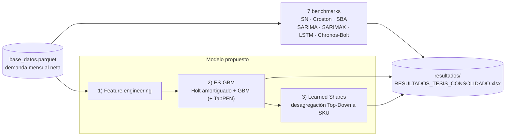
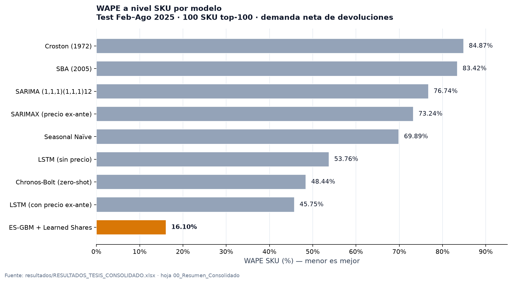

# Pronóstico Jerárquico de Demanda Intermitente en Retail de Moda Femenina

Repositorio acompañante de la memoria de título **aprobada** "Pronóstico Jerárquico de Demanda Intermitente en el Retail de Moda Femenina", presentada para optar al título profesional de Ingeniero Comercial en la Universidad Técnica Federico Santa María.

**Referencia académica:** [registro de la memoria en el repositorio institucional USM](https://repositorio.usm.cl/entities/tesis/e441d202-31da-47a7-b5bd-89cc4b9f702f) · **Autor:** [Joaquín Mondaca](https://github.com/joaquinignaciomondaca-code) · [código fuente de esta investigación](https://github.com/joaquinignaciomondaca-code/Pronostico-Jerarquico-de-Demanda-Intermitente-en-el-Retail-de-Moda-Femenina-main).

- **Problema.** En retail de moda la demanda a nivel SKU es intermitente: acertar a nivel Familia no alcanza para dimensionar compras ni reposición.
- **Enfoque.** Arquitectura híbrida **ES-GBM**: suavizamiento exponencial Holt amortiguado + ensamble de gradient boosting (XGBoost, LightGBM, CatBoost, con TabPFN como variante con gating), ruteo por régimen de crecimiento y desagregación jerárquica Top-Down hacia SKU con *learned shares*.
- **Resultado.** En test (Feb–Ago 2025, 58 Familias y 100 SKU top-100) el modelo alcanza **WAPE SKU 16,1% / WAPE Familia 12,9%**, por debajo de los 7 benchmarks clásicos, estadísticos y fundacionales evaluados (el mejor, LSTM con precio ex-ante, 45,75% / 32,34%).

*Hybrid ES-GBM pipeline for intermittent demand forecasting in fashion retail — hierarchical Top-Down disaggregation to SKU, WAPE 16.1% (SKU) / 12.9% (Family), benchmarked against 7 models including LSTM and Amazon Chronos-Bolt.*

[](https://github.com/joaquinignaciomondaca-code/Pronostico-Jerarquico-de-Demanda-Intermitente-en-el-Retail-de-Moda-Femenina-main/actions/workflows/ci.yml)
[](https://www.python.org/downloads/)

## Estructura del repositorio

```
├── 01_modelos_base/          # Scripts de benchmarks (SARIMA, SARIMAX, LSTM, Chronos, Croston, SBA, SN)
├── 02_modelo_final/          # Pipeline ES-GBM (feature engineering, ensemble, desagregación)
├── resultados/                # RESULTADOS_TESIS_CONSOLIDADO.xlsx (métricas oficiales y detalle)
└── run_all_benchmarks.py     # Orquestador de benchmarks (estiliza el Excel consolidado)
```

## Flujo del pipeline



Notas para quien lee el código:

- Los benchmarks (`01_modelos_base/`) y el pipeline propuesto (`02_modelo_final/`) leen la misma base y reportan sobre la ventana oficial de test (Feb–Ago 2025, métricas netas de devoluciones).
- Los scripts `02_modelo_final/` ejecutan el feature engineering por `exec` y generan sus propias predicciones; `run_all_benchmarks.py` **estiliza** el Excel consolidado — no lo regenera ni recalcula cifras.
- Las cifras oficiales publicadas están en la hoja `00_Resumen_Consolidado` del Excel.

## Scripts principales

| Script | Descripción |
|--------|-------------|
| `01_modelos_base/a)_sarima_topdown.py` | SARIMA univariado con desagregación Top-Down |
| `01_modelos_base/b)_sarimax_topdown.py` | SARIMAX con precio y descuento como regresores |
| `01_modelos_base/c)_lstm_topdown.py` | Red LSTM con y sin precio ex-ante |
| `01_modelos_base/d)_chronos_topdown.py` | Amazon Chronos-Bolt (zero-shot) |
| `01_modelos_base/e)_seasonal_naive_topdown.py` | Seasonal Naïve |
| `01_modelos_base/f)_croston_topdown.py` | Croston clásico |
| `01_modelos_base/g)_sba_topdown.py` | Syntetos-Boylan Approximation |
| `02_modelo_final/1)_feature_engineering.py` | Construcción de features de panel |
| `02_modelo_final/2)_esgbm_ensemble.py` | Calibración del ensamble ES-GBM con ponderaciones NNLS |
| `02_modelo_final/3)_desagregacion_sku_share.py` | Desagregación jerárquica con selección automática de modo estático/dinámico |

## Métricas principales (test, Feb–Ago 2025)

| Modelo | WAPE SKU | WAPE Familia |
|--------|----------|--------------|
| ES-GBM + Learned Shares (propuesto) | 16,10% | 12,89% |
| LSTM (con precio ex-ante) | 45,75% | 32,34% |
| Chronos-Bolt Small (zero-shot) | 48,44% | 36,35% |
| LSTM (sin precio) | 53,76% | 40,51% |
| Seasonal Naïve | 69,89% | 59,78% |
| SARIMAX (con precio ex-ante) | 73,24% | 59,64% |
| SARIMA (1,1,1)(1,1,1)12 | 76,74% | 64,84% |
| SBA (2005) | 83,42% | 74,27% |
| Croston (1972) | 84,87% | 75,41% |

Fuente: `resultados/RESULTADOS_TESIS_CONSOLIDADO.xlsx`, hoja `00_Resumen_Consolidado`. Ventana oficial Feb–Ago 2025 (7 meses), 58 Familias y 100 SKU top-100; las hojas `04`–`10` del consolidado permiten re-verificar cada cifra.

> Nota de trazabilidad (desagregación SKU): el modelo propuesto tiene dos salidas documentadas en el consolidado. La cifra oficial (WAPE SKU = **16,10%**, hoja `02_ESGBM_SKU_Detalle`) corresponde a la desagregación final por shares (selección automática estático/dinámico). La hoja `03_ESGBM_Familia_Detalle` registra la variante auxiliar evaluada dentro del ensemble con proporciones estáticas (WAPE SKU = **29,67%**), con el mismo nivel Familia (12,89%).



*Figura 1. WAPE a nivel SKU por modelo. Menor es mejor; el modelo propuesto (ámbar) supera a los 7 benchmarks. Mismos datos que la tabla anterior.*

## Requisitos

- Python 3.10+
- pandas, numpy, scikit-learn
- xgboost, lightgbm, catboost
- tabpfn
- statsmodels
- torch (para LSTM)
- chronos-forecasting (Amazon Chronos-Bolt)
- tectonic (compilación LaTeX, solo para la tesis)

## Datos

La base de datos (`inputs/base_datos.parquet`) contiene series de demanda mensual anonymizadas y escaladas linealmente por un factor proporcional común para preservar confidencialidad comercial. Las variaciones porcentuales, elasticidades y métricas relativas se mantienen intactas.

Por su tamaño, el parquet no se versiona en este repositorio; está disponible en el repositorio original público: [joako0o/Pronostico-Jerarquico-de-Demanda-Intermitente-en-el-Retail-de-Moda-Femenina](https://github.com/joako0o/Pronostico-Jerarquico-de-Demanda-Intermitente-en-el-Retail-de-Moda-Femenina).

Las columnas `Unidades` y `Monto Neto` vienen **netas de devoluciones** (~10,6% de las líneas de venta son negativas). El pipeline ES-GBM recorta los netos negativos a cero tras la agregación Familia-Mes; los benchmarks (Croston/SBA/Naive) tratan los meses negativos como demanda nula; los totales publicados corresponden a demanda neta.

## Limitaciones (léelas junto con los resultados)

En beneficio de la transparencia técnica:

- **Ventanas de test no uniformes en los benchmarks.** `a)_sarima_topdown.py`, `b)_sarimax_topdown.py` y `d)_chronos_topdown.py` incluyen enero-2025 en la ventana evaluada (`>= CUT_DATE`); el resto de los modelos usa Feb–Ago 2025. Las cifras publicadas en la tabla y el Excel corresponden a Feb–Ago 2025.
- **Alcance SKU distinto.** Los benchmarks clásicos (SARIMA/SARIMAX/Chronos) evaluaron a nivel SKU sobre todo el catálogo; los demás (y los detalles del consolidado), sobre los 100 SKU top-100.
- **Selección de motor de shares sobre test.** `3)_desagregacion_sku_share.py` elige el mejor motor/ensemble con WAPE medido sobre test; la selección estático/dinámico y los pesos del ES-GBM sí se calibran en validación. Queda como deuda técnica corregible (selección en validación).
- **Sesgo leve.** ES-GBM presenta Bias ≈ −4,8% (subestimación) a ambos niveles. Conviene monitorizarlo y calibrarlo antes de un despliegue productivo.
- **Naturaleza de los datos.** `Unidades`/`Monto Neto` vienen netas de devoluciones; ~9,4% de los SKU-meses del test tienen demanda cero (intermitencia). Los MAPE de los benchmarks clásicos superan 100% por los meses de demanda pequeña pero no nula.
- **Muestra y protocolo acotados.** Split temporal único (sin CV rodante), 58 Familias y 100 SKU; las cifras no extrapolan necesariamente a otras temporadas ni a catálogos distintos.
- **Consolidación manual.** El Excel maestro fue ensamblado manualmente a partir de los artefactos de cada script; `run_all_benchmarks.py` no lo regenera ni recalcula.

## Cómo reproducir

1. Python 3.10+: `pip install -r requirements.txt`.
2. Coloca la base en `inputs/base_datos.parquet` (ver "Datos" para la fuente).
3. Benchmarks: ejecuta `python run_all_benchmarks.py` o cada script de `01_modelos_base/` por separado; imprimen sus métricas al final.
4. Modelo propuesto (en orden): `python "02_modelo_final/2)_esgbm_ensemble.py"` y luego `python "02_modelo_final/3)_desagregacion_sku_share.py"` (ambos ejecutan el feature engineering por `exec`).
5. **TabPFN** requiere token de licencia gated (PriorLabs) vía variable de entorno `TABPFN_TOKEN` o caché local; **sin token** el pipeline corre igualmente y omite TabPFN, usando el fallback del ensemble.
6. Costo aproximado: en CPU el ensamble final (8 semillas + calibración NNLS sobre 4 orígenes OOS) toma varias decenas de minutos; los benchmarks clásicos son más rápidos.

## Nota

Este repositorio contiene los scripts del pipeline, el gráfico de resultados y el libro consolidado (`resultados/RESULTADOS_TESIS_CONSOLIDADO.xlsx`); la base de datos de entrada no se versiona (ver sección "Datos").
