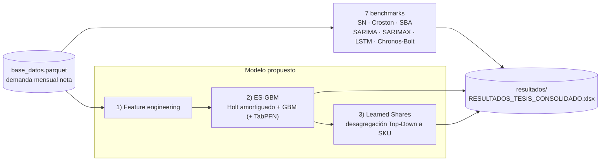

# Pronóstico Jerárquico de Demanda Intermitente en Retail de Moda Femenina

Repositorio acompañante de la memoria de título "Pronóstico Jerárquico de Demanda Intermitente en el Retail de Moda Femenina", presentada para optar al título profesional de Ingeniero Comercial en la Universidad Técnica Federico Santa María.

## Descripción

El pipeline implementa una arquitectura híbrida (ES-GBM) que combina suavizamiento exponencial Holt amortiguado con ensambles de árboles potenciados (XGBoost, LightGBM, CatBoost) y un modelo fundacional tabular (TabPFN), con desagregación jerárquica Top-Down hacia nivel SKU. La evaluación se realizó sobre 7 meses fuera de muestra (febrero–agosto 2025) en 100 SKUs de alto volumen y 58 Familias.

## Estructura del repositorio

```
├── 01_modelos_base/          # Scripts de benchmarks (SARIMA, SARIMAX, LSTM, Chronos, Croston, SBA, SN)
├── 02_modelo_final/          # Pipeline ES-GBM (feature engineering, ensemble, desagregación)
├── resultados/                # RESULTADOS_TESIS_CONSOLIDADO.xlsx (métricas oficiales y detalle)
└── run_all_benchmarks.py     # Orquestador de benchmarks (estiliza el Excel consolidado)
```

## Flujo del pipeline



Notas para quien lee el código:

- Los benchmarks (`01_modelos_base/`) y el pipeline propuesto (`02_modelo_final/`) leen la misma base y reportan sobre la ventana oficial de test (Feb–Ago 2025, métricas netas de devoluciones).
- Los scripts `02_modelo_final/` ejecutan el feature engineering por `exec` y generan sus propias predicciones; `run_all_benchmarks.py` **estiliza** el Excel consolidado — no lo regenera ni recalcula cifras.
- Las cifras oficiales publicadas están en la hoja `00_Resumen_Consolidado` del Excel.
## Scripts principales

| Script | Descripción |
|--------|-------------|
| `01_modelos_base/a)_sarima_topdown.py` | SARIMA univariado con desagregación Top-Down |
| `01_modelos_base/b)_sarimax_topdown.py` | SARIMAX con precio y descuento como regresores |
| `01_modelos_base/c)_lstm_topdown.py` | Red LSTM con y sin precio ex-ante |
| `01_modelos_base/d)_chronos_topdown.py` | Amazon Chronos-Bolt (zero-shot) |
| `01_modelos_base/e)_seasonal_naive_topdown.py` | Seasonal Naïve |
| `01_modelos_base/f)_croston_topdown.py` | Croston clásico |
| `01_modelos_base/g)_sba_topdown.py` | Syntetos-Boylan Approximation |
| `02_modelo_final/1)_feature_engineering.py` | Construcción de features de panel |
| `02_modelo_final/2)_esgbm_ensemble.py` | Calibración del ensamble ES-GBM con ponderaciones NNLS |
| `02_modelo_final/3)_desagregacion_sku_share.py` | Desagregación jerárquica con selección automática de modo estático/dinámico |

## Métricas principales (test, Feb–Ago 2025)

| Modelo | WAPE SKU | WAPE Familia |
|--------|----------|--------------|
| ES-GBM + Learned Shares (propuesto) | 16,10% | 12,89% |
| LSTM (con precio ex-ante) | 45,75% | 32,34% |
| Chronos-Bolt Small (zero-shot) | 48,44% | 36,35% |
| LSTM (sin precio) | 53,76% | 40,51% |
| Seasonal Naïve | 69,89% | 59,78% |
| SARIMAX (con precio ex-ante) | 73,24% | 59,64% |
| SARIMA (1,1,1)(1,1,1)12 | 76,74% | 64,84% |
| SBA (2005) | 83,42% | 74,27% |
| Croston (1972) | 84,87% | 75,41% |

Fuente: `resultados/RESULTADOS_TESIS_CONSOLIDADO.xlsx`, hoja `00_Resumen_Consolidado`. Ventana oficial Feb–Ago 2025 (7 meses), 58 Familias y 100 SKU top-100; las hojas `04`–`10` del consolidado permiten re-verificar cada cifra.

> Nota de trazabilidad (desagregación SKU): el modelo propuesto tiene dos salidas documentadas en el consolidado. La cifra oficial (WAPE SKU = **16,10%**, hoja `02_ESGBM_SKU_Detalle`) corresponde a la desagregación final por shares (selección automática estático/dinámico). La hoja `03_ESGBM_Familia_Detalle` registra la variante auxiliar evaluada dentro del ensemble con proporciones estáticas (WAPE SKU = **29,67%**), con el mismo nivel Familia (12,89%).

## Requisitos

- Python 3.10+
- pandas, numpy, scikit-learn
- xgboost, lightgbm, catboost
- tabpfn
- statsmodels
- torch (para LSTM)
- chronos-forecasting (Amazon Chronos-Bolt)
- tectonic (compilación LaTeX, solo para la tesis)

## Datos

La base de datos (`inputs/base_datos.parquet`) contiene series de demanda mensual anonymizadas y escaladas linealmente por un factor proporcional común para preservar confidencialidad comercial. Las variaciones porcentuales, elasticidades y métricas relativas se mantienen intactas.

Por su tamaño, el parquet no se versiona en este repositorio; está disponible en el repositorio original público: [joako0o/Pronostico-Jerarquico-de-Demanda-Intermitente-en-el-Retail-de-Moda-Femenina](https://github.com/joako0o/Pronostico-Jerarquico-de-Demanda-Intermitente-en-el-Retail-de-Moda-Femenina).

Las columnas `Unidades` y `Monto Neto` vienen **netas de devoluciones** (~10,6% de las líneas de venta son negativas). El pipeline ES-GBM recorta los netos negativos a cero tras la agregación Familia-Mes; los benchmarks (Croston/SBA/Naive) tratan los meses negativos como demanda nula; los totales publicados corresponden a demanda neta.

## Nota

Este repositorio contiene los scripts del pipeline y el libro de resultados consolidado (la base de datos de entrada no se versiona; ver sección "Datos"). La versión LaTeX de la tesis se agregará tras la defensa.
